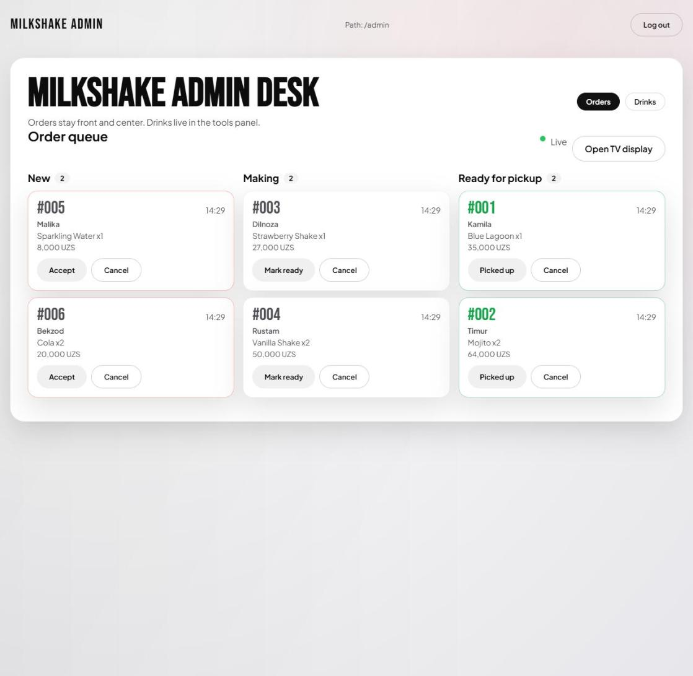
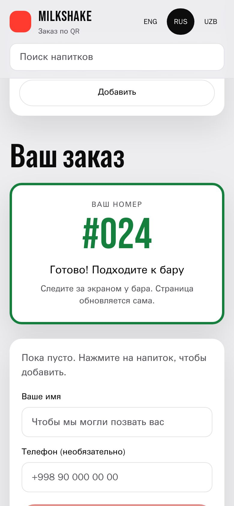
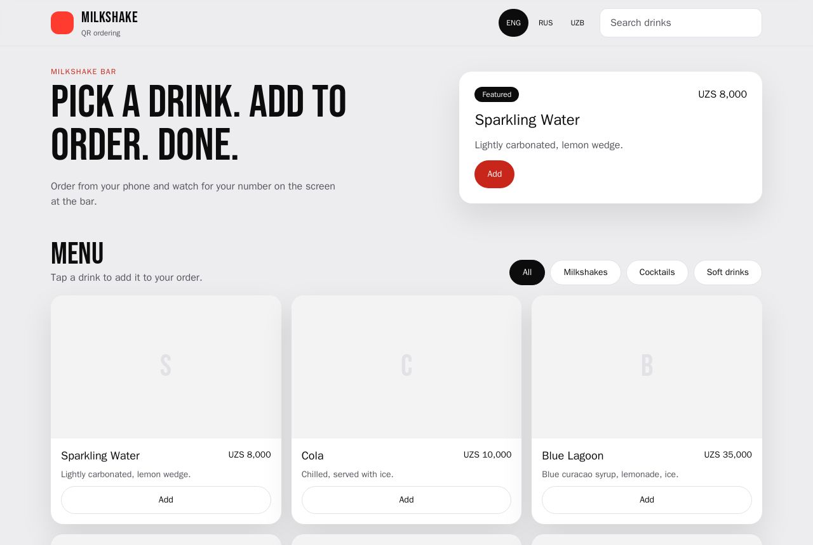
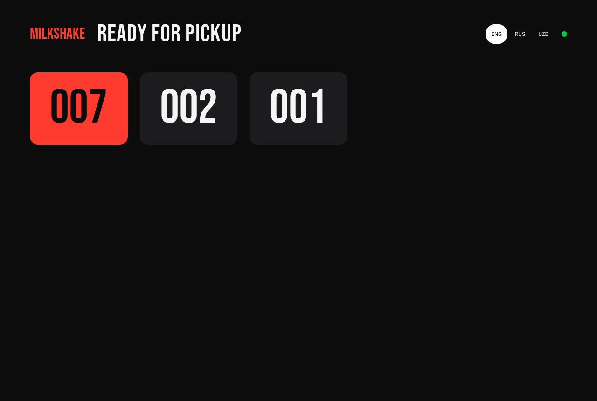

# MilkShake

[](https://github.com/aegusten/MilkShake/actions/workflows/ci.yml)

QR ordering for a drink bar. Guests scan a code, order from their phone and
get a ticket number. Staff work the queue on a tablet. When a drink is ready
the number lights up on a TV by the bar, and the guest's phone flips to
"Ready" on its own. No app to install, no refreshing.

| Staff queue | Guest's phone (Russian) |
|---|---|
|  |  |

| Menu | Pickup TV |
|---|---|
|  |  |

## How it works

1. A guest scans the QR at the bar, picks drinks and places the order. They get ticket `#007`.
2. The order appears on every staff screen instantly under **New**.
3. Staff tap **Accept**, then **Mark ready**. The TV shows `007`, the guest's phone says "Ready! Come to the bar".
4. **Picked up** clears it from the TV. Cancel works from any open state.

Ticket numbers restart at 001 every day at midnight in the bar's timezone.
Everything a guest sees is in English, Russian and Uzbek.

## Stack

| Layer | Tech |
|---|---|
| Backend | FastAPI (async), SQLAlchemy 2.0 + asyncpg, Alembic, Pydantic v2 |
| Realtime | Server-Sent Events, Redis pub/sub across workers (in-process fallback) |
| Frontend | SvelteKit 2 + Svelte 5, Tailwind CSS v4, server-rendered menu |
| Auth | JWT bearer for staff |
| Database | PostgreSQL 15 |
| Quality | pytest (76), Playwright + axe-core (15), ruff, svelte-check, GitHub Actions |
| Infra | Docker Compose |

## Numbers

| Check | Result |
|---|---|
| Lighthouse, menu on a simulated 3G phone (prod build) | Performance 91-94, Accessibility 100, SEO 100 |
| axe-core, WCAG 2.1 A + AA | 0 violations on every screen, in English and Russian |
| Keyboard only | A ticket goes accept, ready, picked up with Enter alone |
| Without JavaScript | Menu renders and the language can be switched |
| Backend coverage | services 96-100%, overall 78% |

## Engineering notes

The parts that were harder than they look:

- **Ticket numbers under concurrency.** Two guests ordering at the same
  instant both read the same `MAX(ticket_number)` and collide. A
  transaction-scoped Postgres advisory lock, keyed per day, serializes
  numbering, with a unique constraint as the backstop. A test fires 50
  orders at once and fails if the lock is removed.
- **The state machine is enforced server-side.** Illegal moves such as
  pending to ready, or anything out of a finished order, return 409. The row
  is locked first, so two staff tapping different buttons can't both win.
- **No lost events on connect.** Each stream subscribes before it reads its
  snapshot, so a change that lands mid-query is still delivered. Reconnects
  get a fresh snapshot instead of replaying history.
- **Dead connections that look alive.** A proxy can keep the browser's
  socket open after the backend dies. The server sends a `ping` event every
  15s, and clients reconnect after 40s of silence.
- **Streams don't pin database connections.** A session taken through
  `Depends` lives until the response ends, which for a stream is when the
  browser leaves. Stream routes use short sessions that close before
  streaming starts.
- **One origin.** The SvelteKit server forwards `/api` and `/uploads` to the
  backend with streaming bodies, so there is no CORS, the backend stays
  private, and SSE passes straight through.
- **Language without a flash.** The locale lives in a cookie, so the server
  renders the right language first time. Translations are a pure function
  of (locale, key) rather than a global store, which on a server would leak
  one guest's language into another's request. Plurals use
  `Intl.PluralRules`, so Russian gets its one/few/many forms.
- **3G first paint.** Fonts are self-hosted instead of a blocking Google
  stylesheet, CSS is inlined, and the production server gzips HTML that was
  44 KB raw. Lighthouse performance went from 81 to 91-94. Event streams are
  excluded from gzip, since compression buffers them.
- **Uploads are checked by content.** Files are accepted by their leading
  bytes, never by the browser's content type or filename, and saved under
  our own extension, so an HTML file posing as an image can't be served
  back as a page.
- **Privacy by audience.** Staff see names and phones. The guest endpoint and
  stream omit both, and the TV gets ticket numbers only.

Design docs: [architecture](docs/ARCHITECTURE.md),
[business rules](docs/BUSINESS_LOGIC.md), [data model](docs/DATA_MODEL.md),
[backlog](docs/BACKLOG.md).

## Run it

Needs Docker with Compose v2. Nothing else on the host.

```bash
git clone https://github.com/aegusten/MilkShake.git && cd MilkShake
cp .env.example .env
# set POSTGRES_PASSWORD, and JWT_SECRET to 32+ chars:
python -c "import secrets; print(secrets.token_urlsafe(48))"

docker compose up -d --build
docker compose exec backend alembic upgrade head
docker compose exec backend python -m app.scripts.seed_data
```

The seed creates sample drinks and an admin `admin@example.com` /
`ChangeMe123`. Change it before any real use.

| URL | For |
|---|---|
| http://localhost:5173 | Guest menu |
| http://localhost:5173/admin | Staff queue and menu editor |
| http://localhost:5173/display | Pickup TV |
| http://localhost:5173/qr | QR code to print or show |
| http://localhost:8000/docs | API (Swagger) |

Containers: Postgres on host port `55432`, Redis (internal only), backend on
`8000`, SvelteKit dev server on `5173`.

### Production build

```bash
docker build --target prod -t milkshake-web ./web
docker run -p 3000:3000 -e BACKEND_URL=http://backend:8000 -e ORIGIN=https://your.domain milkshake-web
```

Put TLS in front (Caddy or nginx). `ORIGIN` must be the public URL.

## Tests

```bash
docker compose exec backend pytest --cov=app          # backend, 76 tests
docker compose exec backend ruff check app tests      # lint

# frontend: accessibility, keyboard, no-JS and translation checks
docker run --rm --ipc=host --network milkshake_default \
  -e BASE_URL=http://frontend:5173 -v "$PWD/web:/app" -w /app \
  mcr.microsoft.com/playwright:v1.49.1-jammy sh -c "npm ci && npx playwright test"
```

CI runs all of it: lint, a migration round trip on an empty database, the
backend suite, `svelte-check`, the production build, and the Playwright suite
against the whole stack in Compose.

## API

| Method | Path | Who |
|---|---|---|
| `POST` | `/api/orders` | Guest. Returns the ticket |
| `GET` | `/api/orders/{id}` | Guest, own order |
| `GET` | `/api/stream/orders/{id}` | Guest, live status (SSE) |
| `GET` | `/api/display/ready` | TV, ready tickets |
| `GET` | `/api/stream/display` | TV, live (SSE) |
| `GET` | `/api/admin/orders?status=` | Staff |
| `POST` | `/api/admin/orders/{id}/{accept,ready,complete,cancel}` | Staff |
| `GET` | `/api/stream/admin` | Staff, live (SSE, bearer auth) |

Menu and upload endpoints are listed in Swagger.

## Configuration

| Variable | Where | Default | Notes |
|---|---|---|---|
| `JWT_SECRET` | backend | none | Required, 32+ chars |
| `JWT_ACCESS_TTL_MINUTES` | backend | `480` | One staff shift |
| `BAR_TIMEZONE` | backend | `Asia/Tashkent` | When ticket numbers reset |
| `REDIS_URL` | backend | unset | Set to share live events across workers |
| `BACKEND_URL` | web | `http://localhost:8000` | Where the web server finds the API. Never sent to browsers |
| `PUBLIC_MENU_URL` | web | request origin | What the QR code points at |
| `ORIGIN` | web (prod) | none | Public URL, required by the Node server |

## Testing on a real phone

Open `http://<your-LAN-IP>:5173/qr` on the computer and scan it with a phone
on the same Wi-Fi. The web server proxies the API, so there is nothing else
to configure.

## Troubleshooting

| Symptom | Fix |
|---|---|
| `port already allocated` | Free 5173, 8000 or 55432, or change the host ports in `docker-compose.yml` |
| `password authentication failed` | The DB volume has an old password. `docker compose down -v` (wipes dev data) |
| Backend fails on `JWT_SECRET` | Missing or under 32 characters |
| Edits don't show up in the browser | Docker on Windows and macOS doesn't forward file events. Compose sets `VITE_USE_POLLING=true`; restart the frontend container if you removed it |
| `Blocked request. This host is not allowed` | Add the hostname to `VITE_ALLOWED_HOSTS` |
| Staff page logs you out | The token expired after 8 hours, or the admin row was recreated. Log in again |

## Status

Done: every phase in [the backlog](docs/BACKLOG.md) except refresh tokens in
HttpOnly cookies (2.5). Not done: testing on physical iOS and Android devices,
and a hosted demo.

## License

[MIT](LICENSE)
