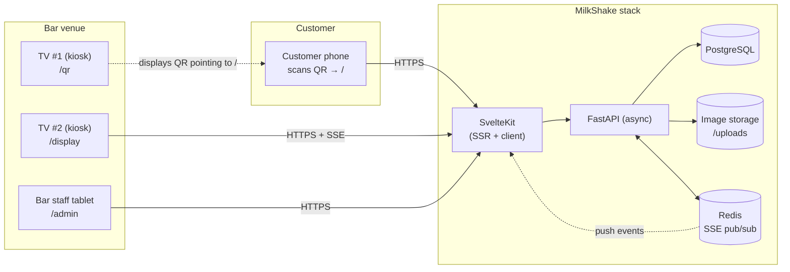

# Architecture

## Overview

MilkShake is a **single-tenant** web application for one milkshake bar. It is
not multi-tenant, has no payment integration (customers pay at the counter),
and has no customer accounts (the ticket number is the customer's identity).

Three independent UIs run on top of one backend:

1. A **customer-facing menu** opened on a personal phone after scanning a QR
   code displayed in the venue.
2. An **admin panel** used by bar staff on a tablet to accept orders and mark
   them ready.
3. Two **TV kiosk screens** in the venue: one shows the QR code customers
   scan; the other shows ticket numbers that are ready for pickup.

## System diagram

## Components

### Backend — FastAPI (async)

Single Python service exposing a REST API plus a Server-Sent Events stream.
Currently sync; **Phase 1** of the refactor migrates to async (`asyncpg` +
`SQLAlchemy AsyncSession`). Lives in [backend/app/](../backend/app/).

Layers:

- `api/` — HTTP route handlers. Thin — no business logic.
- `services/` — Business logic (to be introduced in Phase 3). Order lifecycle,
  ticket-number allocation, image cropping.
- `models/` — SQLAlchemy ORM models.
- `schemas/` — Pydantic request/response models.
- `db.py` — Async engine + session factory.
- `realtime.py` — SSE broadcaster backed by Redis pub/sub (Phase 5).
- `auth.py` — JWT issuance and verification (Phase 2).

### Frontend — SvelteKit

Server-side rendered for the public menu (fast first paint on slow phone
networks) and client-side for the admin and display screens. Lives in
`web/` after the migration (currently `frontend/`).

Pages:

- `+page.svelte` (`/`) — Menu, cart, checkout. SSR for first paint.
- `admin/+page.svelte` — Login + order queue + drink management.
- `qr/+page.svelte` — Renders the venue QR code.
- `display/+page.svelte` — Subscribes to SSE, shows ticket numbers that are
  in `ready` status.

### Database — PostgreSQL 15

One schema, managed by Alembic. See [DATA_MODEL.md](DATA_MODEL.md) for the
full ERD.

### Realtime — Server-Sent Events + Redis

When the admin accepts or readies an order, the backend publishes an event
to Redis. All connected SSE clients (admin panel, `/display`) receive it.
SSE is chosen over WebSockets because the traffic is one-way (server to
clients), and SSE works through corporate firewalls without special config.

### Image storage

Drink cover images are uploaded by the admin, cropped client-side, and stored
on disk under `backend/uploads/`. Served as static files by FastAPI. Migrating
to object storage (S3) is out of scope for v1.

## Routes

| URL | Method | Audience | Purpose |
|---|---|---|---|
| `/` | GET | Customer | Menu, cart, checkout |
| `/admin` | GET | Bar staff | Login + queue + drink CRUD |
| `/qr` | GET | TV #1 | Renders the venue QR code |
| `/display` | GET | TV #2 | Shows ready tickets |
| `/api/drinks` | GET | Public | List drinks for the menu |
| `/api/item-masters` | GET | Public | List item categories |
| `/api/orders` | POST | Public | Place an order, get ticket |
| `/api/admin/login` | POST | Public | Returns JWT |
| `/api/admin/orders` | GET | Admin | Live queue |
| `/api/admin/orders/{id}/accept` | POST | Admin | Move pending → accepted |
| `/api/admin/orders/{id}/ready` | POST | Admin | Move accepted → ready |
| `/api/admin/orders/{id}/complete` | POST | Admin | Move ready → completed |
| `/api/admin/orders/{id}/cancel` | POST | Admin | Move to cancelled |
| `/api/admin/drinks` | CRUD | Admin | Manage drinks |
| `/api/admin/item-masters` | CRUD | Admin | Manage categories |
| `/api/admin/uploads` | POST | Admin | Upload drink image |
| `/api/stream/admin` | GET (SSE) | Admin | Order events stream |
| `/api/stream/display` | GET (SSE) | TV #2 | Ready/completed stream |

## Why this stack

| Choice | Reasoning |
|---|---|
| **FastAPI async** | Order placement and SSE both benefit from async. Auto OpenAPI schema is useful for the SvelteKit frontend during development. |
| **PostgreSQL** | Strong consistency for the order queue. Native ENUMs and `UNIQUE(ticket_date, ticket_number)` constraint. |
| **SvelteKit** | Smallest production bundle of major frameworks → matters on the customer's phone over a venue's weak Wi-Fi. SSR for the menu. File-based routing. |
| **SSE over WebSocket** | One-way push, no client-to-server protocol. Survives reverse proxies and corporate firewalls without special configuration. |
| **Redis pub/sub** | Lets the backend run multiple workers without losing events. Cheap; Docker-friendly. |
| **JWT auth** | Stateless; works across page reloads and SSE reconnects. Short-lived (15 min) access tokens + longer refresh tokens. |

## Deployment topology (target)

- **VPS (single host)** running Docker Compose: Postgres, Redis, backend,
  frontend. Caddy or nginx in front for TLS.
- **Backups**: nightly `pg_dump` to off-host storage.
- **Uptime**: docker-compose `restart: unless-stopped`. Health checks on
  `/healthz`.

Out of scope for v1: Kubernetes, multi-region, CDN. The bar has one venue.
