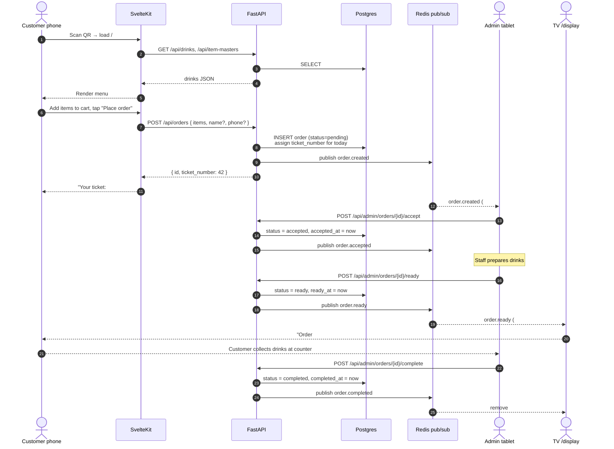
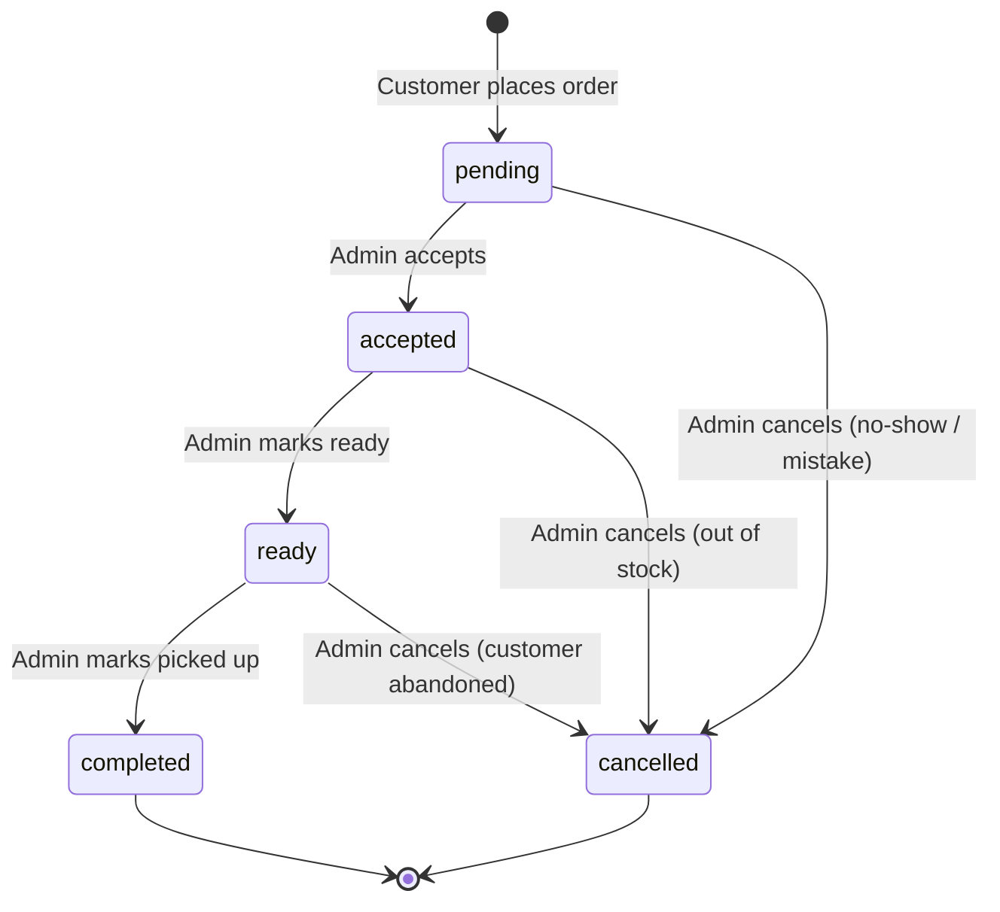

# Business Logic

This document defines the rules of the system: who does what, in what order,
and what is and is not allowed. Code must conform to this; if a behavior is
not described here, treat it as undefined and ask before implementing.

## Actors

| Actor | Authenticated? | Device |
|---|---|---|
| Customer | No | Personal phone (QR-scanned) |
| Bar staff | Yes (admin login) | Bar tablet |
| Bar owner | Yes (admin login) | Same as bar staff |
| TV `/qr` screen | No | Browser kiosk on TV |
| TV `/display` screen | No | Browser kiosk on TV |

There is no distinction between "staff" and "owner" in v1, both share the
admin role.

## Order placement flow

## Customer rules

- **No login.** The customer does not register or log in.
- **No required fields.** A valid order needs at least one cart item. Name
  and phone are optional metadata that may help staff, but the ticket number
  is the customer's identity.
- **No payment in app.** Customers pay at the counter when collecting their
  drink. The order can still be cancelled by the admin if the customer
  doesn't show up.
- **One ticket per order.** Multiple drinks in one cart produce one ticket
  number. If the same customer wants a second drink later, they place a new
  order and get a new ticket.
- **No duplicate drink lines in the same order.** The API merges quantities
  before saving: ordering 2x Vanilla then adding another Vanilla becomes
  3x Vanilla in one row. The DB enforces `UNIQUE(order_id, drink_id)`.

## Admin rules

- **Authentication required.** Every state-changing admin endpoint requires
  a valid JWT in the `Authorization: Bearer` header.
- **Status transitions are enforced by the backend**, not the UI. The state
  machine below is authoritative, invalid transitions return 409.
- **Cancellation is permanent.** Cancelled orders cannot be re-opened. A new
  ticket would be issued instead.
- **No editing of existing orders.** Once placed, line items are immutable.
  Wrong order → cancel and the customer re-orders.

## Ticket numbering

- Numbers are **3-digit, zero-padded**: `#001`, `#042`, `#317`.
- Numbers **reset to `#001` at local midnight** (bar's timezone, configured
  via `BAR_TIMEZONE` env var; defaults to `Asia/Tashkent` based on the
  current locale of the UI).
- The database stores both `ticket_number` (integer 1-999) and
  `ticket_date` (DATE in bar timezone). The pair is `UNIQUE`.
- **Allocation is race-safe.** The backend uses an advisory lock or a
  per-day sequence; concurrent orders within the same millisecond cannot
  receive the same number. If a number is somehow rejected by the unique
  constraint, the service retries with `MAX(ticket_number) + 1`.
- **Overflow at 999.** Extremely unlikely for one bar, but the schema
  permits it (4-digit numbers are still 3+ digits, just longer). If the
  business ever hits this, switch to alphanumeric prefix scheme.
- **Numbers are reused across days.** Today's #042 and yesterday's #042 are
  different orders; the `ticket_date` disambiguates.

## Order state machine

| From | To | Trigger | Allowed? |
|---|---|---|---|
| pending | accepted | Admin clicks "Accept" | Yes |
| pending | ready |, | No (must go through accepted) |
| pending | cancelled | Admin clicks "Cancel" | Yes |
| accepted | ready | Admin clicks "Ready" | Yes |
| accepted | cancelled | Admin clicks "Cancel" | Yes |
| ready | completed | Admin clicks "Picked up" | Yes |
| ready | cancelled | Admin clicks "Cancel" | Yes (customer abandoned) |
| completed | * |, | No (terminal) |
| cancelled | * |, | No (terminal) |

## TV `/display` rules

- Shows tickets with status = `ready` only. Tickets disappear from the
  display the moment the admin marks them `completed`.
- Ordered by `ready_at DESC` (newest ready first, so customers see fresh
  notifications at the top).
- **Auto-clears at midnight** alongside the ticket counter reset.
- If the SSE connection drops, the page automatically reconnects and fetches
  the current `ready` list on reconnect, never shows stale data.
- The page should be safe to run unattended for days in a browser kiosk: no
  modals, no errors visible to customers, no auto-refresh that wipes the
  list mid-render.

## Menu / catalog rules

- **Drinks must belong to at least one item master** (category). A drink with
  zero item masters is rejected at creation.
- **A drink can belong to multiple item masters.** Many-to-many: a
  "Strawberry shake" might be under both "Milkshakes" and "Featured".
- **Deleting an item master does not delete its drinks**, only removes the
  association.
- **Drink prices are stored in UZS** (Uzbekistani sum) as `NUMERIC(10,2)`.
  The frontend formats with `Intl.NumberFormat("uz-UZ")`.

## Internationalization

The customer-facing menu supports three languages: English, Russian,
Uzbek. The admin panel and TV screens are English-only in v1.

Language is **client-side preference only**, not stored in the database
or per-user.

## Out of scope (v1)

These are explicitly **not** implemented and not promised to the customer:

- Customer accounts, login, history.
- In-app payment (Click, Payme, card).
- SMS / push notifications when an order is ready.
- Inventory tracking / out-of-stock flags.
- Multiple venues / multi-tenant.
- Custom drink modifications (e.g., "extra sugar", "no whip").
- Order editing after placement.
- Refunds / partial cancellations.

If the customer asks for these, they're a v2 conversation. See
[BACKLOG.md](BACKLOG.md) for what's planned.
