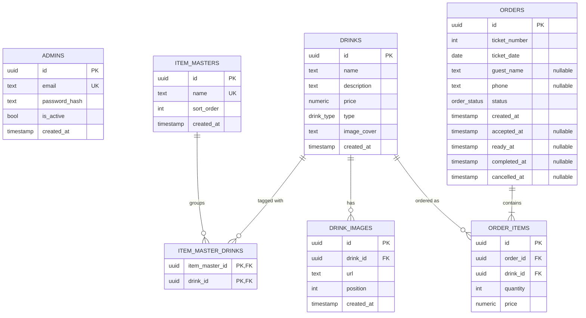

# Data Model

PostgreSQL 15. Schema managed by Alembic ([backend/alembic/versions/](../backend/alembic/versions/)).

## ERD



## Tables

### `admins`
Bar staff and owner accounts.

| Column | Type | Notes |
|---|---|---|
| `id` | `uuid` PK | |
| `email` | `text` UNIQUE | Lowercase enforced in the API |
| `password_hash` | `text` | bcrypt via passlib |
| `is_active` | `bool` | Disabled admins cannot log in |
| `created_at` | `timestamp` | |

### `item_masters`
What a customer calls "categories" — e.g. "Milkshakes", "Cocktails",
"Featured". The internal name `item_master` is preserved from the existing
schema; renaming is out of scope.

| Column | Type | Notes |
|---|---|---|
| `id` | `uuid` PK | |
| `name` | `text` UNIQUE | Display name |
| `sort_order` | `int` | Lower values appear first |
| `created_at` | `timestamp` | |

### `drinks`
Menu items.

| Column | Type | Notes |
|---|---|---|
| `id` | `uuid` PK | |
| `name` | `text` | |
| `description` | `text` | Up to 160 chars (enforced in Pydantic) |
| `price` | `numeric(10,2)` | UZS |
| `type` | `drink_type` ENUM | `soft \| milkshake \| cocktail \| other` |
| `image_cover` | `text` | Relative URL e.g. `/uploads/abc.jpg` |
| `created_at` | `timestamp` | |

Indexes: `idx_drinks_type` on `type`.

### `item_master_drinks` (M2M join)

| Column | Type | Notes |
|---|---|---|
| `item_master_id` | `uuid` PK,FK | ON DELETE CASCADE |
| `drink_id` | `uuid` PK,FK | ON DELETE CASCADE |

### `drink_images`
Up to three secondary images per drink (the primary is on `drinks.image_cover`).

| Column | Type | Notes |
|---|---|---|
| `id` | `uuid` PK | |
| `drink_id` | `uuid` FK | ON DELETE CASCADE |
| `url` | `text` | |
| `position` | `int` | CHECK between 1 and 3 |
| `created_at` | `timestamp` | |

Constraints: `UNIQUE(drink_id, position)`.

### `orders` (target schema — post-refactor)
One customer order. Phase 4 of the refactor adds the ticket-numbering and
status fields.

| Column | Type | Notes |
|---|---|---|
| `id` | `uuid` PK | |
| `ticket_number` | `int` | 1–999. Resets daily in bar timezone. |
| `ticket_date` | `date` | Date in bar timezone. |
| `guest_name` | `text` NULL | Optional. |
| `phone` | `text` NULL | Optional. |
| `status` | `order_status` ENUM | `pending \| accepted \| ready \| completed \| cancelled` |
| `created_at` | `timestamp` | |
| `accepted_at` | `timestamp` NULL | Set when admin accepts |
| `ready_at` | `timestamp` NULL | Set when admin marks ready |
| `completed_at` | `timestamp` NULL | Set when customer picks up |
| `cancelled_at` | `timestamp` NULL | Set when admin cancels |

Constraints:

- `UNIQUE(ticket_date, ticket_number)` — race-safe daily ticket allocation.
- `CHECK (ticket_number BETWEEN 1 AND 999)`.
- `CHECK (status != 'cancelled' OR cancelled_at IS NOT NULL)` — terminal
  timestamps must be set when transitioning to terminal states.

Indexes:

- `idx_orders_status_date` on `(status, ticket_date)` — used by `/display`
  and the admin queue.
- `idx_orders_ticket_lookup` on `(ticket_date, ticket_number)` — used when
  the admin looks up a ticket.

### `order_items`

| Column | Type | Notes |
|---|---|---|
| `id` | `uuid` PK | |
| `order_id` | `uuid` FK | ON DELETE CASCADE |
| `drink_id` | `uuid` FK | ON DELETE RESTRICT — preserves history |
| `quantity` | `int` | Must be ≥ 1 (Pydantic) |
| `price` | `numeric(10,2)` | Captured at order time (price drift safe) |

Constraints:

- `UNIQUE(order_id, drink_id)` — no duplicate drink lines per order. The API
  merges duplicates before insert.

## Enums

```sql
CREATE TYPE drink_type AS ENUM ('soft', 'milkshake', 'cocktail', 'other');
CREATE TYPE order_status AS ENUM
    ('pending', 'accepted', 'ready', 'completed', 'cancelled');  -- Phase 4
```

## Invariants

These should be true at all times. Tests should cover them.

1. Every `order_items.price` matches the `drinks.price` at the time the order
   was placed, **not** the current `drinks.price`. Editing a drink's price
   does not retroactively change existing orders.
2. An order is in exactly one status. Status transitions follow the state
   machine in [BUSINESS_LOGIC.md](BUSINESS_LOGIC.md). Direct DB updates that
   skip states are bugs.
3. For each `(ticket_date, ticket_number)` pair there is at most one order.
4. Every drink has at least one item master while it exists.
5. `order_items.drink_id` always references a still-existing drink (RESTRICT
   on delete). To "remove" a drink that has historical orders, admins should
   archive it (a future `is_archived` flag — not in v1).

## Migrations (current state)

| Revision | Description |
|---|---|
| `0001_init` | Initial schema: admins, drinks, drink_categories, drink_images, orders, order_items |
| `0002_category_parent` | Adds parent_id to drink_categories (later dropped) |
| `0003_item_masters` | Replaces drink_categories with item_masters + M2M |

## Planned migrations (refactor)

| Revision | Description | Phase |
|---|---|---|
| `0004_order_status_and_tickets` | Adds `status`, `ticket_number`, `ticket_date`, lifecycle timestamps, `order_status` enum | 4 |
| `0005_orders_guest_name_nullable` | Drops NOT NULL on `orders.guest_name` | 4 |
